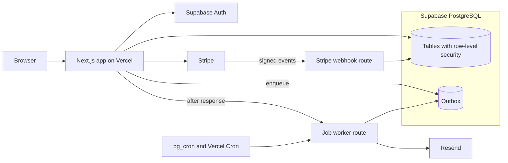

# TalentYak Technical Overview

TalentYak connects Nepali fitness coaches with clients abroad. I built the application as the sole developer.

This overview focuses on the backend decisions behind the product: who can access a record, how payment events are processed, how money is calculated, and how background work is recovered.

## Architecture

The application uses Next.js and TypeScript, with Supabase providing PostgreSQL and authentication. Stripe handles payment integration. Database-backed jobs support background processing.

## Access to private records

Coaching records should only be available to the people entitled to see them. Access is enforced through PostgreSQL row-level security rather than relying only on hidden buttons or frontend checks.

The database test suite includes scenarios for different customer, coach, and administrative roles. These tests require a configured test database.

[Review the permission tests](../web/test/db/access-matrix.db.test.ts)

## Money calculations

Financial calculations use integer minor units with explicit currency handling. This avoids treating every currency as if it had the same decimal precision.

Tests cover currency mismatches, rounding, allocation, and preservation of totals.

[Review the money tests](../web/src/lib/money/money.test.ts)

## Payment events

A payment provider can deliver an event more than once or deliver events out of order. The webhook implementation verifies signatures, records receipts, and controls processing through database-backed state.

The processing path checks current provider state before applying payment effects. Failed processing can be retried.

[Review the webhook implementation](../web/src/lib/payments/webhook.ts) · [Review the event-rule tests](../web/src/lib/payments/events.test.ts)

## Background work

Background jobs are written to a database-backed outbox. An immediate worker attempt handles work promptly, while scheduled processing provides a recovery path.

This separates the user’s request from tasks that may need another attempt.

[Review the outbox implementation](../web/src/lib/worker/outbox.ts)

## Verification and limitations

The repository includes unit tests, database integration tests, and verification scripts. Some checks require external services or a configured test database.

A test file being present does not establish that it passed in every environment. Skipped checks and unavailable services should remain visible in test results.

This overview describes implementation choices. It does not claim audited security, production scale, or commercial payment activity.
